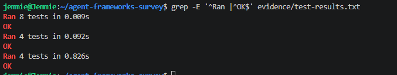

# Agent Frameworks Survey

[](https://github.com/jemmie2025/agent-frameworks-survey/actions)

## Overview

Engineering evaluation of LangGraph, CrewAI, AutoGen and Claude Agent SDK to determine their suitability for enterprise AI orchestration, operational reliability and deployment efficiency.

## Implementations

- **LangGraph:** Stateful research workflow with explicit graph execution, checkpointing and citation validation.
- **CrewAI:** Role-based research and summarization agents with controlled tool execution and sequential task handoff.

Both implementations use a shared research corpus and deterministic offline models. Live OpenAI integration is configured but remains unvalidated.

## Verified Results

| Metric | LangGraph | CrewAI |
|---|---:|---:|
| Benchmark success | 5/5 | 5/5 |
| Median workflow latency | 10 ms | 190.7 ms |
| Mean end-to-end latency | 903.71 ms | 4145.19 ms |
| Docker disk usage | 298 MB | 1.51 GB |

- 16 automated tests passed.
- Consistent source-referenced outputs.
- Non-root, network-isolated containers.
- Successful GitHub Actions validation.

Results represent deterministic offline execution, not live LLM inference.

## Quick Start

Requirements: Docker and GNU Make.

```bash
git clone https://github.com/jemmie2025/agent-frameworks-survey.git
cd agent-frameworks-survey
make docker-build
make docker-test
```

No API credentials are required for offline execution.

## Engineering Controls

Pinned dependencies, isolated environments, configured execution limits, read-only research tools, Git and Docker credential exclusions, structured execution metrics, non-root containers, network-isolated offline execution and automated CI validation.

## Documentation

- [Technical Evaluation and Decision Matrix](report.md)
- [System Architecture](docs/architecture.md)
- [Operational Runbook](docs/runbook.md)
- [Performance Benchmarks](evidence/benchmark-results.json)
- [Automated Test Results](evidence/test-results.txt)

## Recommendation

Adopt LangGraph for controlled, stateful enterprise workflows and CrewAI for collaborative multi-agent workloads. Consider Claude Agent SDK for Claude-native automation.

AutoGen is archived; evaluate Microsoft Agent Framework for new implementations.

## Implementation Scope and Limitations

The project is a validated offline proof of concept, not a production deployment.

| Component | Actual status |
|---|---|
| LangGraph and CrewAI | Implemented and validated offline |
| Live GPT inference | Configured, not tested |
| Claude Agent SDK | Researched only |
| AutoGen | Researched only |
| PostgreSQL persistent state | Recommended, not implemented |
| Prometheus, Grafana and Vault | Proposed architecture |
| External observability integration | Not validated |
| Vulnerability scanning | Not performed |
| Production load testing | Not performed |
| Persistent state recovery | Not validated |
| AI-generated summary accuracy | Not evaluated |

Citation validation verifies source identifiers, not factual accuracy. Container validation confirms non-root execution and network isolation, not comprehensive security certification.

## Validation Evidence

### Automated Testing

All 16 automated tests passed across both framework implementations.



### Performance and Container Validation

Repeated benchmarks, Docker image comparison and non-root execution validation.


