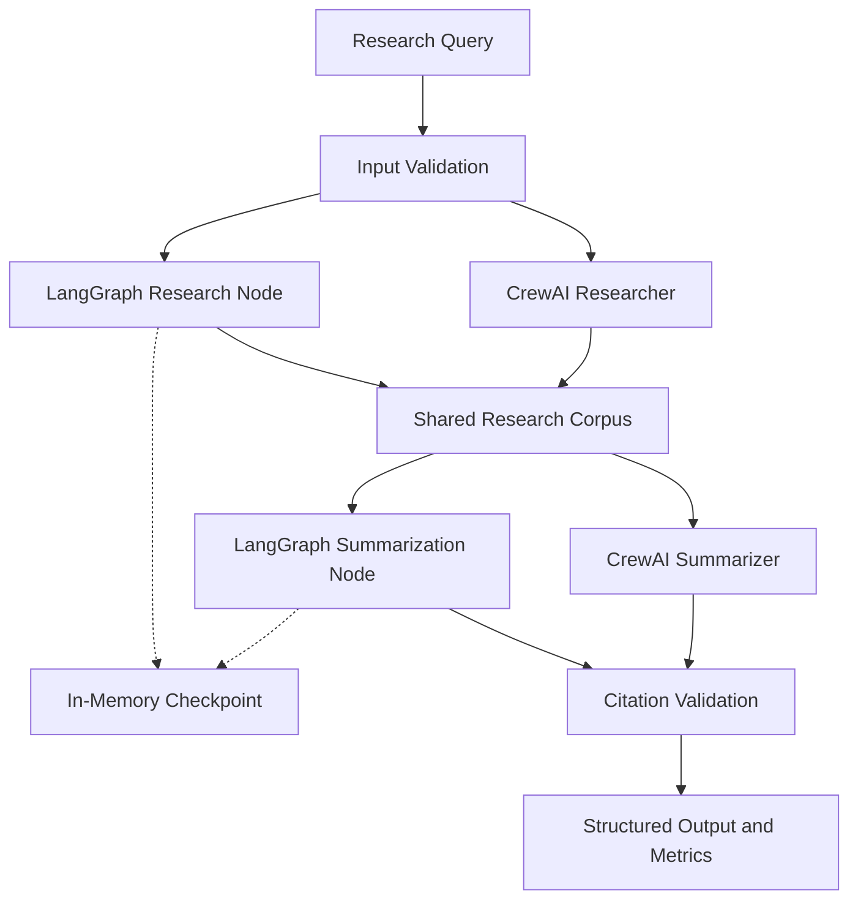
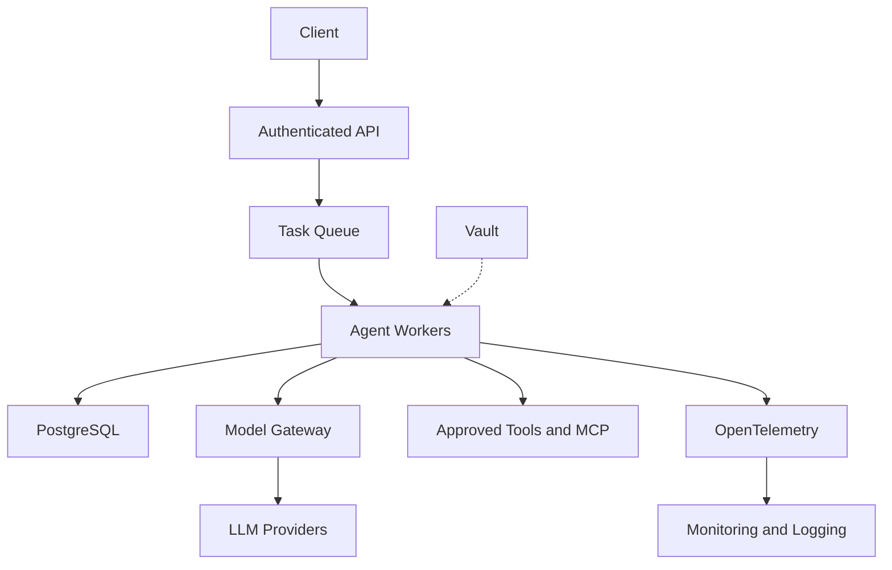

# System Architecture

## Implemented Workflows

Both implementations use isolated dependencies, shared model configuration and non-root Docker containers.

## Proposed Production Architecture

## Design Decisions

| Decision | Rationale |
|---|---|
| Isolated workers | Dependency and workload separation |
| Model gateway | Routing, quotas and cost management |
| Persistent state | Recovery and workflow continuity |
| Restricted tools | Least-privilege execution |
| Centralized telemetry | Operational visibility and auditability |

The production architecture is proposed. Only the offline proof-of-concept workflows have been deployed locally and validated.
